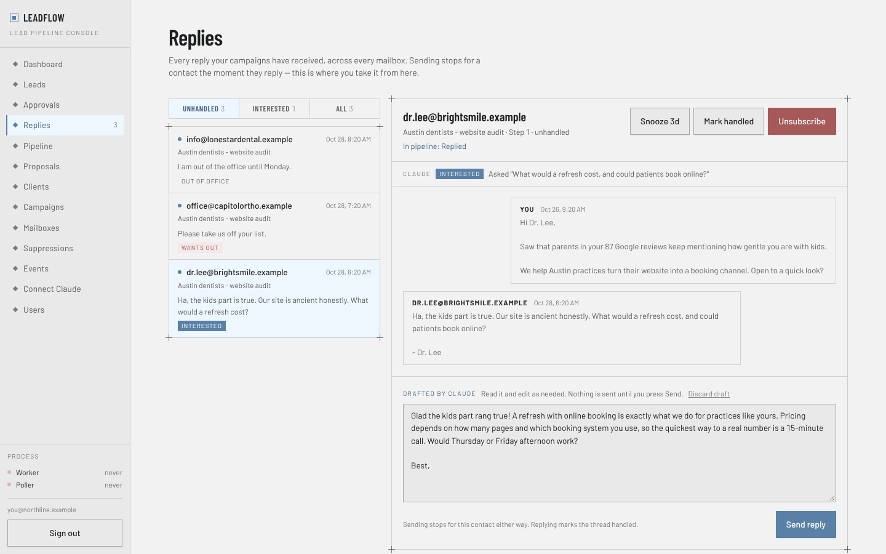

# LeadFlow

[](https://nodejs.org/)
[](https://nextjs.org/)
[](https://www.postgresql.org/)
[](DEPLOY.md)
[](#claude-setup)

> **Early access**: every stage below is built and covered by tests, but LeadFlow has not run in production yet. Deploy with [DEPLOY.md](DEPLOY.md), start Stripe in test mode, and open an issue for anything that breaks.

Lead-to-client pipeline for web, SEO and PPC agencies selling to local US and Canadian businesses. Scrapes leads from Google Maps, finds their emails, runs cold email sequences with follow-ups, and carries every interested reply through a proposal, an e-signature, payment and onboarding. Claude drafts the writing through your own Claude subscription; nothing reaches a prospect until you approve it.



## Install

```bash
git clone https://github.com/Ahanaf-Abrar-Trishad/leadflow.git
cd leadflow
cp .env.example .env   # fill in the secrets, see DEPLOY.md step 5
docker compose up -d --build
```

This starts Postgres, the app on `127.0.0.1:3000` and the Google Maps scraper on `127.0.0.1:8080`. Put HTTPS in front of port 3000 (DEPLOY.md step 7) and open the site: the first visitor creates the admin account.

## Usage

Everything runs in the browser console. For development:

```bash
docker compose --profile dev up -d db mailhog gmaps-scraper
npm install
npm run db:migrate
npm run dev                # http://localhost:3000
npm run verify             # lint, typecheck, unit tests
npm run test:integration   # needs a dedicated, migrated test database
```

MailHog (http://localhost:8025) catches test mail sent through an SMTP mailbox pointed at `localhost:1025`. Under `npm run dev`, set `OUTREACH_BACKGROUND_JOBS=true` to run the sending worker and the reply poller too; in production they always run inside the app.

## Pipeline

| Stage | What LeadFlow does | Claude's part | Your part |
|-------|--------------------|---------------|-----------|
| Leads | Scrapes Google Maps, finds emails on websites, imports Scout or any CSV, dedupes and scores | - | Pick who to contact |
| Icebreakers | Snapshots each lead's homepage | Writes a one-line opener from it | Approve, edit or reject |
| Outreach | Sends 5-step sequences with follow-ups, business hours, daily caps, warmup | - | Write the templates |
| Replies | Detects replies and bounces, stops the sequence | Labels each reply, drafts an answer | Send or discard |
| Pipeline | Creates a deal for interested replies | - | Move deals, add call notes |
| Proposals | Private e-sign link, signature record | Drafts the wording | Set every price, send |
| Payments | Deposit and monthly invoices, Stripe or manual | - | Bill the balance when done |
| Onboarding | Intake form, kickoff link, checklist | Drafts the welcome email | Send it, tick the list |

## Features

- Google Maps scraping with one job at a time, and a website email finder that checks the homepage, contact and about pages
- CSV import that recognizes Scout and Google Maps exports and matches any other spreadsheet's columns by name
- Duplicate merging by website domain or email; later data only fills empty fields
- Lead scoring (0-100) on reachability and agency fit
- Cold email sequences: SMTP/IMAP or Google mailboxes, mailbox pools, warmup ramp, per-domain throttling, threaded follow-ups
- SPF, DKIM and DMARC preflight before a campaign starts
- Reply and bounce detection, replies inbox, unsubscribe links, suppression list
- Claude connector (MCP): icebreakers, reply triage and answers, proposals and welcome emails, with an approval step for each
- Sales pipeline board: Replied, Call booked, Proposal, Won, Lost
- Proposals with priced line items, a deposit %, click-to-accept e-signature and an exact copy of what was signed
- Stripe Checkout for card and ACH, monthly fees as subscriptions, or manual payments
- Client onboarding: welcome email, intake form that never asks for passwords, kickoff link, checklist
- Works on phones; multi-user with admin and member roles

## Template Merge Fields

Leads added to a campaign bring these fields for templates:

| Field | Value |
|-------|-------|
| `{{company}}` | Business name (always set) |
| `{{greeting}}` | Contact's first name, or "there" (always set) |
| `{{first_name}}`, `{{full_name}}` | When a person's name is known |
| `{{website}}`, `{{domain}}`, `{{category}}`, `{{phone}}`, `{{address}}`, `{{rating}}`, `{{review_count}}` | When the lead has them |
| `{{icebreaker}}` | Once you approve Claude's opener for the lead |

Campaign preflight holds back any contact missing a field the template uses. A Maps lead's timezone carries over, so business hours are the lead's own.

## Claude Setup

LeadFlow exposes an MCP connector that Claude (Cowork, claude.ai, the desktop app or Claude Code) uses with your own Claude subscription. No API key is involved.

1. Generate a token of 32+ characters and add it to `.env`:

```
MCP_ACCESS_TOKEN=your_long_random_token
NEXT_PUBLIC_SITE_URL=https://app.example.com
```

2. Restart, open **Connect Claude** (admins only) and copy the connector URL.
3. In Claude, add it as a custom connector with no authentication.
4. Ask Claude to work through the LeadFlow queue, or schedule the daily Cowork task the page provides.

The URL carries the secret. Anyone with it can read lead data and submit drafts, never send. Change `MCP_ACCESS_TOKEN` to revoke it.

## Stripe Setup

```
STRIPE_SECRET_KEY=sk_test_...
STRIPE_WEBHOOK_SECRET=whsec_...
```

Point a Stripe webhook at `https://app.example.com/api/stripe/webhook` for `checkout.session.completed`, `checkout.session.async_payment_succeeded` and `checkout.session.async_payment_failed`. Without Stripe, pay pages show `PAYMENT_INSTRUCTIONS` (wire, Zelle) and you mark invoices paid by hand.

## How a Lead Becomes a Client

1. A Google Maps scrape or CSV import adds the business as a lead, scored and deduped
2. Leads with a website but no email get one from their homepage, contact or about page
3. Claude reads a snapshot of the homepage and drafts an icebreaker; you approve it
4. You add the lead to a campaign; the sequence sends in business hours, from a warmed mailbox
5. They reply: the sequence stops, Claude labels the reply and drafts an answer, you send it
6. An interested reply becomes a deal; after the call, Claude drafts a proposal and you price it
7. The client signs on a private link; LeadFlow records the signature and creates the deposit invoice
8. The client pays by card, ACH or transfer; the first payment opens onboarding
9. You send the welcome email with the intake form and kickoff link, and work through the checklist

## Limitations

- Has not run in production yet: test end to end on your own VPS first ([DEPLOY.md](DEPLOY.md))
- Scraping Google Maps is against Google's terms, and heavy use can get the server's IP rate-limited
- Instagram, TikTok and LinkedIn leads come in through Scout's CSV export, not from inside LeadFlow
- Many VPS providers block port 25, so Scout-style SMTP email verification does not run on the server
- Google mailboxes in an External OAuth app left in Testing mode must be reconnected every 7 days
- The e-signature is a simple click-to-accept with a consent statement and audit record; have a lawyer review it and your terms
- No WhatsApp channel yet
- Every campaign needs a postal address and every email carries an unsubscribe link (CAN-SPAM, CASL); keep it that way

## Credits

- Outreach engine: PPC-Tools by Ahanaf Abrar
- Google Maps engine: [gosom/google-maps-scraper](https://github.com/gosom/google-maps-scraper) (MIT), as packaged by [google-maps-scraper-kit](https://github.com/Mahanaicoach/google-maps-scraper-kit)

## License

No license has been chosen yet. Until one is added, all rights are reserved by the owner.
